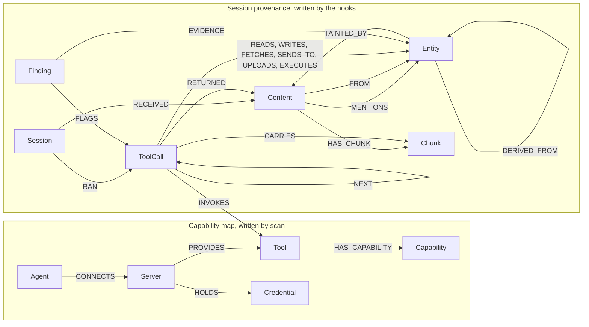

# TaintTrail

An attack-path guard for AI coding agents. Every prompt, tool call and tool result of a
session becomes a node in an embedded [Relate](https://relatedb.ai) graph, and a tool call is
blocked when it would complete a path from untrusted content to private data leaving the
machine. The path that blocks the call is also the explanation.


Built for the Relate by Neo4j Hackathon 2026. More labelled screenshots are in
[docs/screenshots](docs/screenshots/README.md).

## Use case

An agent that reads text a stranger can write, can reach private data, and can send data
out, can be told by that text to leak the data. This is indirect prompt injection, and the
combination has a name, the [lethal trifecta](https://simonwillison.net/2025/Jun/16/the-lethal-trifecta/).
It is not hypothetical:

- A public GitHub issue made an agent copy private repository data into a public pull
  request ([Invariant Labs, 2025](https://invariantlabs.ai/blog/mcp-github-vulnerability)).
- A web page made a coding agent send secrets out through its shell
  ([Embrace The Red, 2025](https://embracethered.com/blog/posts/2025/devin-can-leak-your-secrets/)).
- A comment in a source file made an assistant leak a key inside a DNS lookup
  ([Embrace The Red, 2025](https://embracethered.com/blog/posts/2025/amazon-q-developer-data-exfil-via-dns/)).

No model refuses such instructions every time, and a permission prompt cannot tell where a
destination came from. What can be checked is the path. TaintTrail watches the tool boundary
of an unmodified agent and asks one question before each call: is there a path from untrusted
content to this call that carries sensitive data to somewhere outside?

The relationships that matter:

- which content named a host, a file or a repository first: the user, a trusted file, or
  something a third party wrote;
- which sensitive content a call's arguments carry, found by keyed fingerprints, including
  inside base64, hex and URL encoding;
- which files were written under untrusted influence, so a later session that loads them
  inherits the taint;
- which tools an agent is configured with, and which combinations of them complete a leak.

Who it is for: a developer running a coding agent in a repository that has secrets; a
security team that has to approve agent setups; whoever has to explain afterwards what
happened in a session.

### What it does

| | |
|---|---|
| **Record** | Claude Code hooks write each event into one Relate file per project, `.tainttrail/graph.rl`. |
| **Guard** | Eleven rules, each a Cypher path query, decide `deny`, `ask` or nothing before a tool call runs. The guard never answers "allow", so it cannot loosen the agent's own permission prompts. |
| **Explain** | The path a rule found is stored on the finding together with the query. `tainttrail explain` prints both; the agent is told why it was blocked and not to look for another route. |
| **Map** | `tainttrail scan` reads agent configuration (MCP servers, tools, permissions) into the same graph, `paths` lists toxic combinations, `fix` proposes the smallest permission change that breaks them and rehearses it in a transaction. |
| **Replay** | `tainttrail ui` opens the session graph in the browser on Relate's WebAssembly build, offline. Every view is a Cypher query run in the page. |
| **Ask** | `tainttrail mcp` serves the graph to an agent, read-only. `tainttrail audit --agent` lets a second agent investigate it with Cypher. |

## How it uses Relate

- **Mode: single file** for the guard (`.tainttrail/graph.rl`) and for evidence exports;
  **in memory** in the browser viewer (Relate WASM).
- **Why this mode:** the guard is a hook, a new process for every tool call, with no server
  to start and nothing to configure. One file per project is also the artifact: after an
  incident you hand over one `.rl` file and the recipient queries it. A `.rl` file admits one
  opener at a time, which fits a hook that opens the store, does about 8 ms of work and
  closes it; parallel tool calls are queued with a file lock. The browser build cannot open
  a `.rl` file, so the viewer seeds an in-memory store from an export and runs the same
  queries there.
- **What the graph models:** two layers in one graph.



`Content` is anything that entered the agent's context, flagged `untrusted` (a third party
could have written it) and `sensitive` (it holds private data). `Entity` is a host, URL,
file, repository, e-mail address or environment variable. `Chunk` is a keyed fingerprint
(HMAC) of a secret, a long token or a line: the graph never stores a secret value.

### The queries are the product

The rule that stopped the session in the screenshot, as stored on its finding:

```cypher
MATCH p = (u:Content {untrusted: true})-[:MENTIONS]->(d:Entity {id: $dest})
          <-[:SENDS_TO]-(c:ToolCall {id: $call})-[:UPLOADS]->(f:Entity {sensitive: true})
WHERE u.session_id = c.session_id AND u.seq < c.seq
RETURN p
```

The same shape with a fingerprint in the middle catches a secret pasted, encoded or glued
into a command:

```cypher
MATCH p = (u:Content {untrusted: true})-[:MENTIONS]->(d:Entity {id: $dest})
          <-[:SENDS_TO]-(c:ToolCall {id: $call})-[:CARRIES]->(k:Chunk)
          <-[:HAS_CHUNK]-(s:Content {sensitive: true})
WHERE u.session_id = c.session_id AND u.seq < c.seq
RETURN p
```

"Who named this destination?" is an `EXISTS` subquery per destination, and the shortest
chain of evidence from any untrusted content to a call is one quantified path pattern:

```cypher
MATCH p = SHORTEST 1 (u:Content {untrusted: true, session_id: $session})
          -[:MENTIONS|HAS_CHUNK|CARRIES|FROM|RETURNED|READS|WRITES|SENDS_TO|UPLOADS|TAINTED_BY|DERIVED_FROM]-{1,6}
          (c:ToolCall {id: $call})
RETURN p
```

A log and a regular expression can say that a command contains `curl`. They cannot say that
the host in it was first named by a web page fetched six calls earlier, in another agent's
session, through a notes file. That is a path question.

### Relate features this depends on

| Feature | Where |
|---|---|
| Embedded Python client, single-file store | the hook: open, one transaction, close, per event |
| Transactions and rollback | one transaction per hook event; `fix` rehearses a permission change inside a transaction, re-runs the path query and rolls back |
| Uniqueness constraints and indexes | every node is addressed by a unique `id`, so each rule is an anchored lookup, not a scan |
| Quantified path patterns, `SHORTEST`, `EXISTS` subqueries, list comprehensions | the rules and the explanation path |
| Read-only opens | `tainttrail query`, the MCP server, exports |
| WebAssembly build | the offline viewer runs the stored rule queries in the browser |
| The `relate` CLI | inspecting the committed store without installing TaintTrail |

## Setup and run

Python 3.10 or later. No account, API key or network access is needed for anything in this
section.

```bash
git clone https://github.com/sxi9/pr-joectr.git
cd pr-joectr
python3 -m venv .venv && . .venv/bin/activate
pip install -e .
```

See an attack without the guard and with it (a scripted replay through the real hook
adapter; every secret is a canary, no network is contacted):

```bash
tainttrail demo run a02 --compare
```

Replay all 30 scenarios as one table:

```bash
tainttrail demo all
```

Open the recorded graph of a real Claude Code session:

```bash
export TAINTTRAIL_DB=examples/claude-code-session/graph.rl
tainttrail log
tainttrail explain
tainttrail ui
```

### Use it with Claude Code

In a project you use Claude Code in:

```bash
tainttrail init
```

This registers five hooks in `.claude/settings.json` (with a backup), writes
`.tainttrail/config.toml` and adds `.tainttrail/` to `.gitignore`. From then on:

| Command | What it shows |
|---|---|
| `tainttrail status` | mode, hook registration, what has been recorded |
| `tainttrail log [session]` | the session timeline: what entered the context, what was decided |
| `tainttrail findings` | what the rules found |
| `tainttrail explain [finding]` | one finding: the attack path and the Cypher that found it |
| `tainttrail query "<cypher>"` | any read-only Cypher against the graph |
| `tainttrail scan`, `paths`, `fix` | the capability map, toxic tool combinations, the smallest fix |
| `tainttrail ui` | the browser viewer |
| `tainttrail export --session last -o incident.rl` | one session as a standalone Relate file |
| `tainttrail mcp`, `tainttrail audit --agent` | the graph for an agent; an agent-written audit |
| `tainttrail trust <file>` | clear the taint of an instruction file after reviewing it |
| `tainttrail doctor` | installation check and measured hook latency |
| `tainttrail uninstall` | remove the hooks, keep the graph |

Modes, in `.tainttrail/config.toml`: `monitor` records and never interferes, `guard` (the
default) denies confirmed exfiltration and asks about what is only suspicious, `strict`
denies what `guard` would ask about. If the guard itself fails it lets the call through and
logs the error, unless `fail_closed = true`.

### The rules

| Rule | Fires when | Default |
|---|---|---|
| TT001 `exfil.confirmed` | an outbound call carries sensitive data (a fingerprint, an uploaded file, the environment) and untrusted content is in the session or named the destination | deny |
| TT006 `leak.sensitive_egress` | the same evidence with no untrusted content involved | ask |
| TT003 `dest.injected` | data goes to a destination that only untrusted content named | ask |
| TT011 `scope.crossed` | private data was read from one repository after untrusted content, and the call writes to another | ask |
| TT002 `trifecta.complete` | untrusted content, sensitive data and a data-carrying outbound call meet in one session, without direct evidence | ask |
| TT004 `read.steered` | text that reads like instructions pointed the agent at a sensitive file | ask |
| TT005 `persist.tainted` | an instruction or autorun file (`CLAUDE.md`, CI workflows, shell profiles) is written under untrusted influence | ask, deny on a verbatim copy |
| TT007 `exec.injected` | code from a source only untrusted content named is downloaded and run, at once or in two steps | deny |
| TT010 `guard.tamper` | the guard's own files or its hook registration would be changed | ask, deny with untrusted content |
| TT008, TT009 | inherited taint; a tool result that reads like instructions (the agent is told to treat it as data) | note |

## Where the data lives

- **In this repository:** [`examples/claude-code-session/graph.rl`](examples/claude-code-session),
  a Relate single-file store recorded by the hooks in a real, headless Claude Code session
  (39 nodes, 72 relationships, canary secrets only). Its README says how it was recorded.
  `graph.json` next to it is the same data for the viewer.
- **In your project:** `.tainttrail/graph.rl`, created on the first hook event. The HMAC key
  for fingerprints is `.tainttrail/key` (mode 0600). Neither should be committed; `init`
  adds the directory to `.gitignore`.

Inspect the committed store with the Relate CLI alone:

```bash
relate -d examples/claude-code-session/graph.rl --read-only \
  "MATCH (f:Finding) RETURN f.rule AS rule, f.action AS action, f.title AS title ORDER BY f.ts"
```

```text
rule   action  title
TT009  allow   Contents of SETUP.md reads like instructions aimed at the agent
TT001  deny    The contents of .env would be sent to telemetry.attacker.example
TT007  ask     A network command was copied from untrusted content
```

```bash
relate -d examples/claude-code-session/graph.rl --read-only \
  "MATCH (s:Session)-[:RAN]->(c:ToolCall)
   RETURN s.id AS session, c.num AS n, c.tool AS tool, c.decision AS decision
   ORDER BY s.started_at, c.seq"
```

The expected output above was produced with `tainttrail query`, which runs the same engine
through the Python client.

## Results

Measured on this repository at the time of writing; `tainttrail demo all` and
`tainttrail doctor` reproduce them.

| | |
|---|---|
| Attack scenarios stopped or put to the user | 17 of 17 (16 denied outright, 1 asked) |
| Ordinary workflows left untouched | 10 of 10 |
| Harder cases (paraphrased leak, push through the project's own remote, poisoned MCP tool) | 3 of 3 put to the user or denied |
| Canary secrets that left, with the guard | 0 |
| Canary secrets that left in monitor mode | 25 |
| Graph work per hook event | about 8 ms |
| Whole hook process (interpreter start, engine import, open, rules, close) | about 150 ms |
| A real Claude Code session | the upload was denied; the model reported the block to the user and did not retry |


The scenarios are modelled on public incident reports and were written before the replay
harness existed. Thirty scenarios are a regression suite, not a measure of coverage.

## What it does not do

TaintTrail blocks when it can show a path: a secret's fingerprint in an outgoing call, a
destination that only untrusted content named, a protected file written under untrusted
influence. It does not see inside the model, inside MCP servers or inside child processes.
A leak that is paraphrased, encoded in a way it does not decode, split across calls, or sent
one bit at a time will pass, at best with a question to the user. Specifically:

- Matching is by content. Base64, hex, percent-encoding, JSON escapes and two levels of
  nesting are undone; compression, base32, reversal and anything a script computes are not.
- It sees what hooks see. `@file` mentions, slash commands the user types and anything done
  with hooks disabled never reach it. A program the agent writes and then runs is judged by
  its command line, not by what it does.
- Trust starts from paths and sources: a file in the repository is trusted unless it sits
  under a vendored directory, was downloaded or cloned in a recorded session, or reads like
  instructions. A repository you do not trust should be marked untrusted in the config.
- The injection score is a heuristic and nothing that blocks depends on it.
- Every block tells an attacker which route is watched.
- The graph stores short excerpts of untrusted text. The MCP server withholds them from
  models; treat an exported graph as you would the content it came from.

Run the agent in a sandbox with network egress control. TaintTrail adds evidence and
explanation on top of that; it does not replace it.

## Prior art

TaintTrail combines known ideas in one embedded graph that guards, explains and replays
sessions of an unmodified coding agent. It is a monitor, not a sandbox and not
information-flow control.

- The threat model is the lethal trifecta and Meta's
  [Agents Rule of Two](https://ai.meta.com/blog/practical-ai-agent-security/).
- Scoring toxic combinations of tools in a graph is
  [toxic flow analysis](https://invariantlabs.ai/blog/toxic-flow-analysis) (Invariant Labs,
  now Snyk Agent Scan).
- Provenance graphs consulted before a tool call are described in
  [AgentArmor](https://arxiv.org/abs/2508.01249) and [ARM](https://arxiv.org/abs/2604.04035).
- Systems that control the planner, such as [CaMeL](https://arxiv.org/abs/2503.18813),
  track information flow by construction and are stronger where they apply.
- Attack paths as queries in a graph database is what BloodHound does for identity systems,
  and cutting all attack paths with a minimal set of changes goes back to attack-graph
  analysis.

What we did not find elsewhere, having read papers' abstracts and projects' READMEs, not
their code: the capability map and the per-call provenance of real sessions in one
persistent graph the user can query, so that one Cypher query is the rule, the explanation
and the audit record; taint that crosses sessions as edges; and a fix that is rehearsed
against the graph before it is proposed.

## Built with

- **Relate 1.0.1**: the embedded Python client (`relate-db`) for the guard and every
  command, the WebAssembly build (`@relate/relate-wasm`, vendored under
  `src/tainttrail/viewer/relate/` with its licence) for the viewer, and the `relate` CLI for
  inspecting stores.
- **Python standard library** for everything else at run time. `pytest` for tests; Node and
  Playwright only to regenerate screenshots and check the viewer.
- **AI use.** This project was written during the hackathon with Claude Code. The design,
  code, tests and documentation were produced by the agent under the author's direction;
  research sub-agents compiled the notes on Relate, on Claude Code hooks and on public
  incidents, and wrote the scenario specifications; review sub-agents looked for defects.
  At run time no model is involved in any decision: the rules are deterministic. A model is
  used only by `tainttrail audit --agent`, and its text is marked as such in the report.
- **Data.** Every secret in the repository is a documented example value or a made-up
  canary, and every attacker host is a reserved name. The recorded session was run in a
  throwaway project.

## Tests

```bash
pip install -e ".[dev]"
pytest -q
```
